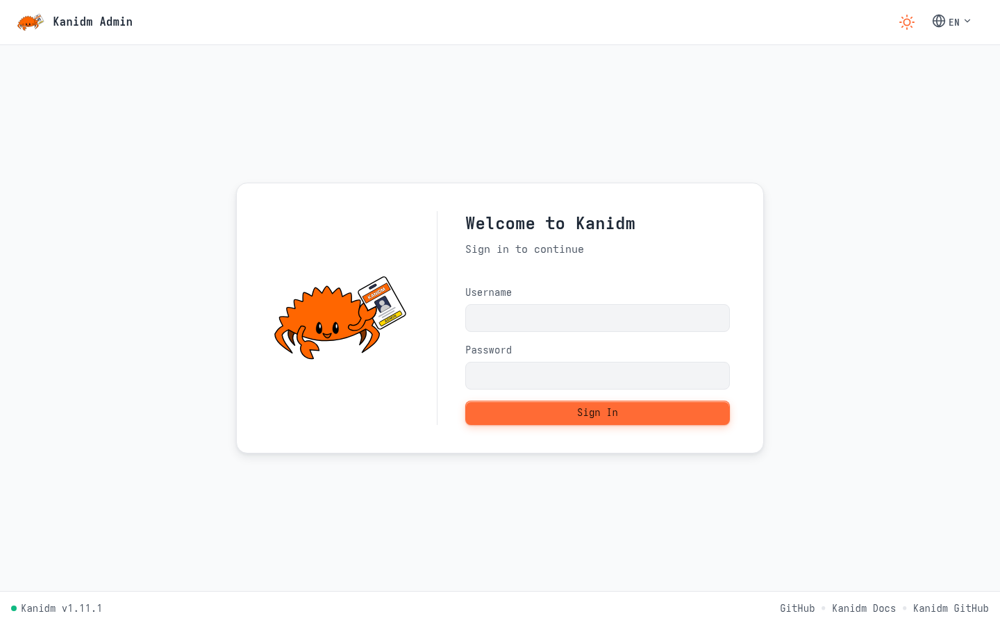
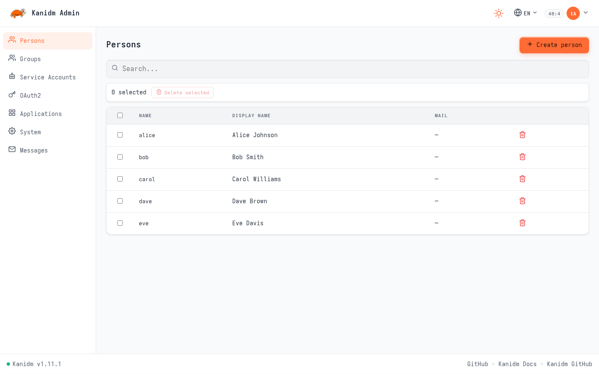
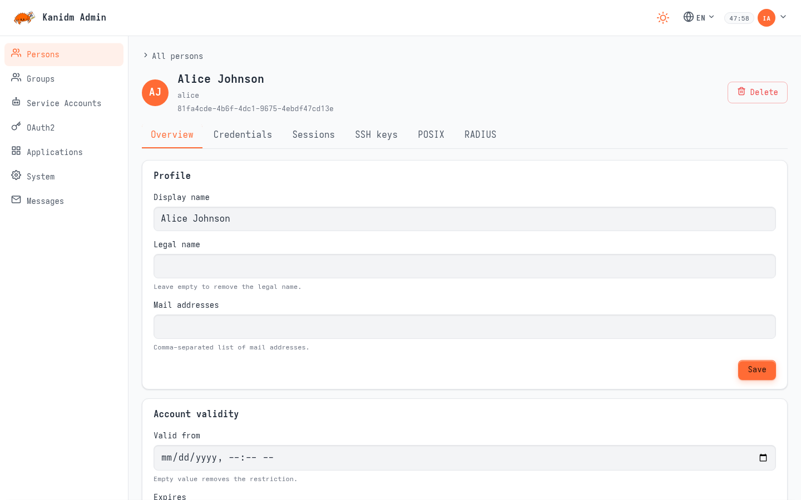
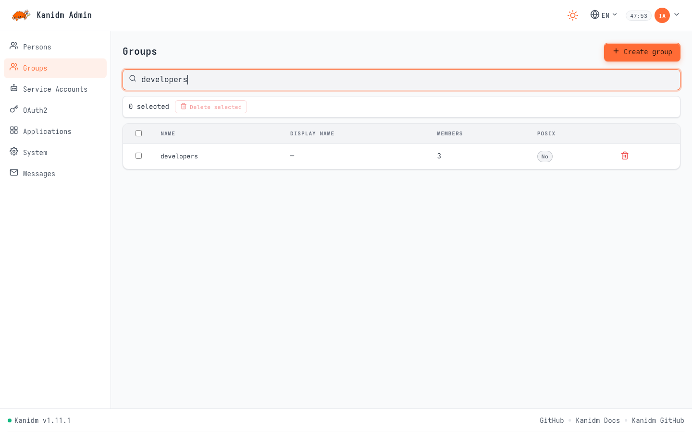
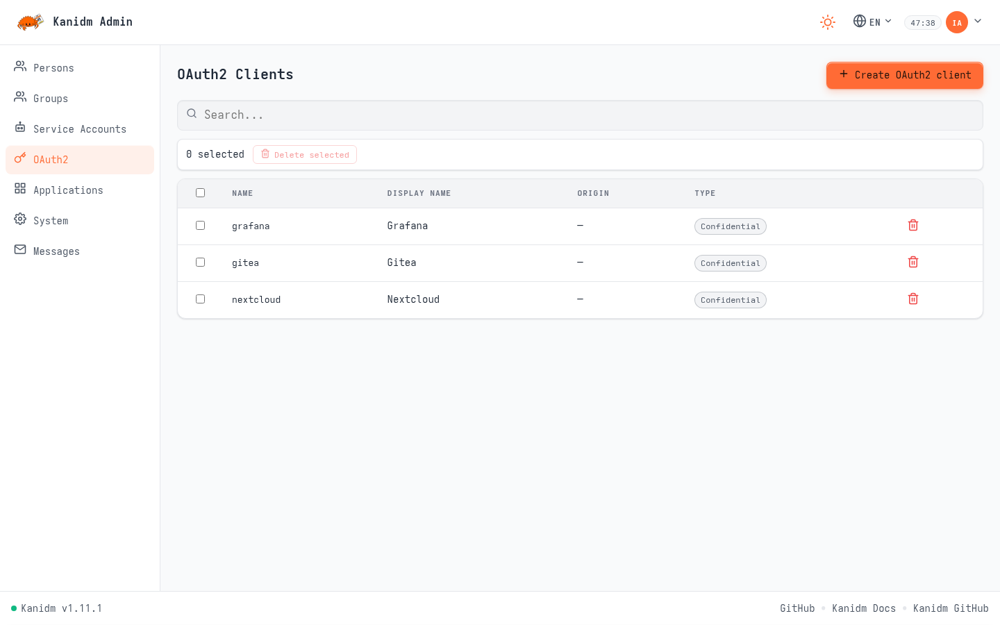
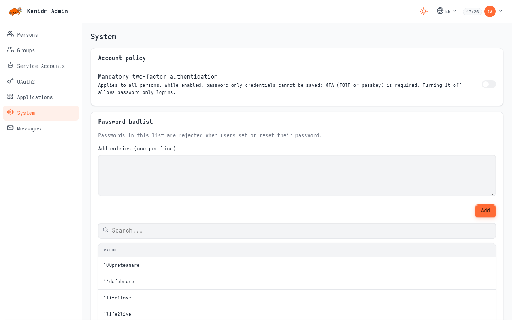

# Kanidm Admin

[](LICENSE)


A modern web-based administration console for
[Kanidm](https://github.com/kanidm/kanidm) — a simple, secure and fast
identity management platform (identity provider) written in Rust.

Kanidm Admin talks to a Kanidm server through its HTTP API and provides a
clean, responsive UI for day-to-day identity administration: people, groups,
service accounts, OAuth2 clients and more.

> **Note:** Kanidm Admin is an independent companion project and is not part
> of the upstream [Kanidm](https://github.com/kanidm/kanidm) codebase. For
> server installation, configuration and general documentation, see the
> official [Kanidm book](https://kanidm.github.io/kanidm/stable/).

## Screenshots

<p align="center">
  <picture>
    <source media="(prefers-color-scheme: dark)" srcset="docs/screenshots/login-dark.png">
    
  </picture>
</p>

<p align="center">
  <picture>
    <source media="(prefers-color-scheme: dark)" srcset="docs/screenshots/persons-dark.png">
    
  </picture>
</p>

<p align="center">
  <picture>
    <source media="(prefers-color-scheme: dark)" srcset="docs/screenshots/person-detail-dark.png">
    
  </picture>
</p>

<p align="center">
  <picture>
    <source media="(prefers-color-scheme: dark)" srcset="docs/screenshots/groups-dark.png">
    
  </picture>
</p>

<p align="center">
  <picture>
    <source media="(prefers-color-scheme: dark)" srcset="docs/screenshots/oauth2-dark.png">
    
  </picture>
</p>

<p align="center">
  <picture>
    <source media="(prefers-color-scheme: dark)" srcset="docs/screenshots/system-dark.png">
    
  </picture>
</p>

<p>
  The full set — including light and dark variants of every page, detail
  views and mobile layouts — lives in
  <a href="docs/screenshots/">docs/screenshots/</a>.
</p>

## Features

- **Persons** — search, create, edit and delete people and their attributes
- **Groups** — group management and membership
- **Service Accounts** — manage machine/service identities
- **OAuth2** — configure OAuth2 resource servers and clients
- **Applications, system settings, messages** — further admin sections
- **Sync & recycle bin** — sync state overview and soft-deleted entry recovery
- **Session auth** — password sign-in with session cookies and privilege
  step-up (re-authentication) for sensitive actions
- **Secure proxying** — the Rust backend proxies Kanidm API calls on behalf
  of the authenticated session; no direct browser-to-Kanidm traffic
- **Light & dark themes** — with flash-free theme initialization
- **Internationalization** — English, Russian, Spanish, Simplified Chinese
- **Version compatibility indicator** — footer status dot and banner when the
  connected Kanidm server version drifts outside the supported band
- **Single-binary deployment** — release builds embed the compiled SPA
  (`rust-embed`); production ships one static binary

## Tech Stack

| Layer     | Technology                                        |
| --------- | ------------------------------------------------- |
| Backend   | Rust, Axum, Tokio, tower-http, `kanidm_client`    |
| Frontend  | TypeScript, Lit 3, Vite                           |
| Auth      | Kanidm password login, session cookies, step-up   |

## Requirements

- **Rust** (stable, recent) — backend and release builds
- **Bun** — frontend toolchain for local builds and the dev loop
- **Docker** *(optional)* — for the bundled development Kanidm container and
  the production image

## Quick Start

### Development

```bash
git clone https://github.com/zyrakq/kanidm-admin.git
cd kanidm-admin
cargo run            # server starts at http://localhost:4000
```

In development mode the app automatically starts an **ephemeral Kanidm
container** (`kanidm/server:1.11.2` via Docker), provisions it and recovers
the built-in admin credentials — no pre-existing Kanidm server needed.
Frontend source edits trigger a rebuild (`bun watch`) and are served live.

To develop against an existing Kanidm instance instead:

```toml
# app/appsettings.toml (or a local overlay)
[kanidm]
url = "https://idm.example.com"

[kanidm_container]
enabled = false
```

### Production build

```bash
cargo build --release    # SPA is compiled and embedded into the binary
```

### Docker

```bash
docker compose up -d     # builds the image and serves on port 4000
```

### Docker image build check (pipelight)

The production image build is scripted as a
[pipelight](https://pipelight.dev) pipeline (`pipelight.toml` at the repo
root). It builds the same image `docker compose` runs:

```bash
pipelight run docker-build   # builds kanidm-admin:local
```

Validate the pipeline definition without building:

```bash
pipelight ls
```

The pipeline is manual-only (no triggers). To run it automatically on
`git push`, opt in with pipelight's git hooks:

```bash
pipelight enable git-hooks
```

The same pipeline runs in CI on every push/PR to `master`
(`.github/workflows/pipelight.yml`).

### Releases

Cut a release by pushing a version tag (or using the *Run workflow* button
on `.github/workflows/release.yml` with a version input):

```bash
git tag v0.1.0 && git push origin v0.1.0
```

The workflow builds the image, pushes `ghcr.io/zyrakq/kanidm-admin:X.Y.Z`
and `:latest`, and creates a GitHub Release with pull/run instructions.
Images are amd64; point the container at your Kanidm instance by mounting a
TOML overlay into `/workspace/app` — there is no env-var override for
`kanidm.url` (see the release notes for the exact command).

## Configuration

Settings are layered TOML files: `app/appsettings.toml` (base), then
`app/appsettings.{APP_ENV}.toml` (`APP_ENV` defaults to `development`).

| Setting                 | Default                        | Description                                     |
| ----------------------- | ------------------------------ | ----------------------------------------------- |
| `server.address`        | `0.0.0.0:4000`                 | HTTP bind address                               |
| `frontend.serve_from`   | `disk` (dev) / `embedded` (prod) | Serve the SPA from disk or the embedded assets |
| `frontend.watch`        | `false`                        | `bun watch` live rebuild (development)          |
| `kanidm.url`            | `https://localhost:8443`       | Kanidm server URL                               |
| `kanidm_container.enabled` | `false` (`true` in dev)     | Start an ephemeral Kanidm container at startup  |
| `kanidm_container.image`   | `kanidm/server:1.11.2`      | Image used for the dev container                |

## Kanidm Compatibility

Kanidm Admin targets Kanidm **1.11.x** (the `kanidm_client` version pinned in
`Cargo.toml`). Compatibility is a declared band around that pinned version —
same major, minor within ±1. When the connected server drifts outside the
band, the UI shows an amber or red banner and footer indicator; it stays
usable either way.

## Related Projects

- [Kanidm](https://github.com/kanidm/kanidm) — the identity provider this
  tool administers
- [Kanidm book](https://kanidm.github.io/kanidm/stable/) — official server
  documentation

## License

Distributed under the [MIT License](LICENSE).
Kanidm itself is licensed under the
[MPL-2.0](https://github.com/kanidm/kanidm/blob/master/LICENSE.md).
